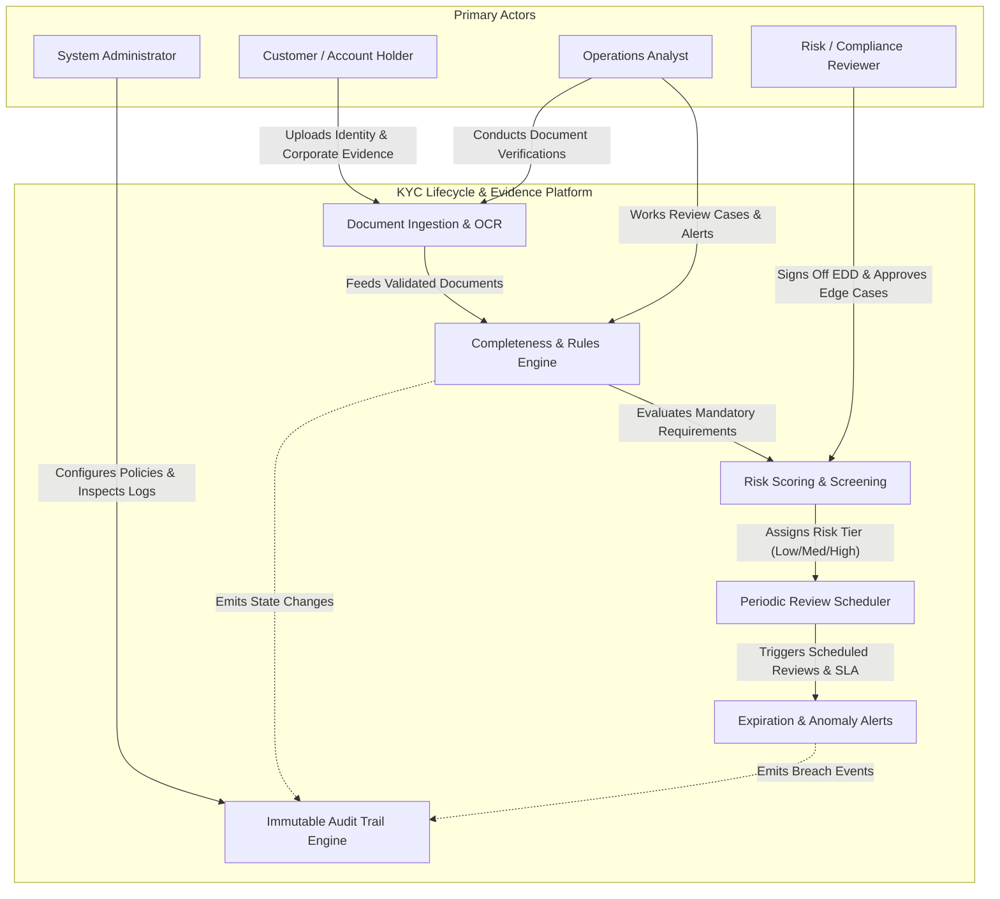
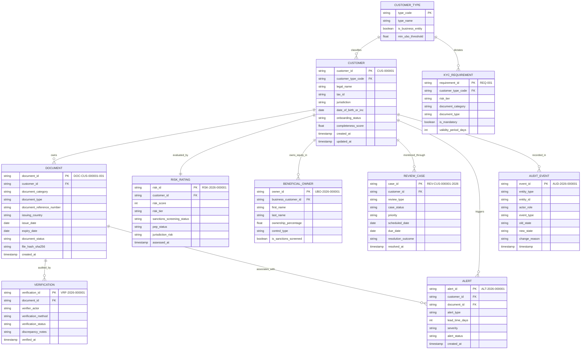
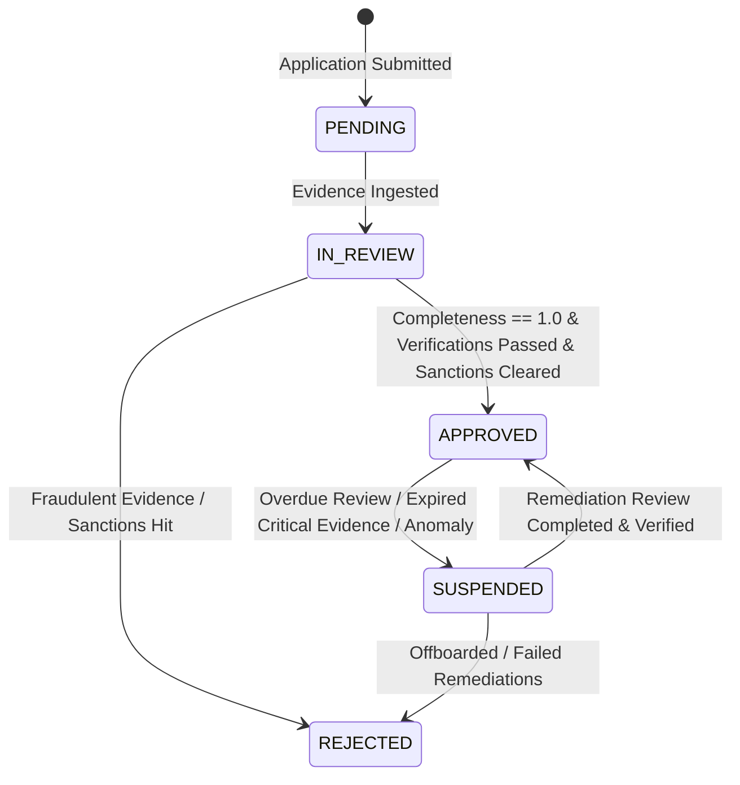
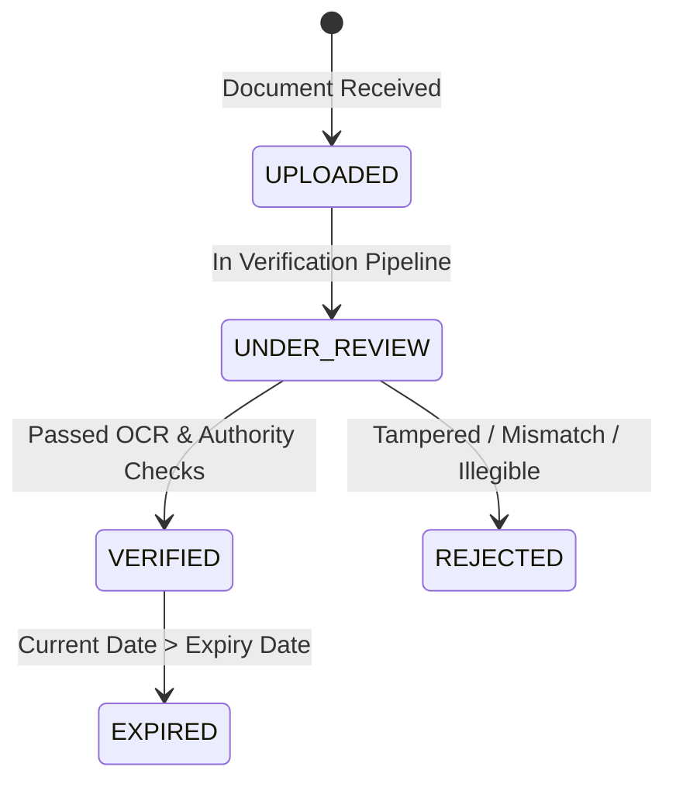

# Complete Subject Guide & Architecture: KYC Onboarding Evidence, Completeness & Lifecycle Management

This guide explains the domain concepts, regulatory underpinnings, lifecycle state machines, actor responsibilities, and architectural design of the **KYC Onboarding Evidence Tracking and Lifecycle Management System**.

---

## 1. Domain Deep Dive & Subject Explanation

### 1.1 What is KYC & Why Does It Exist?
**Know Your Customer (KYC)** is the foundational regulatory process that banks, fintechs, brokerages, and cryptocurrency institutions use to verify customer identity, understand the customer's financial profile, and assess the risk of money laundering, terrorist financing, and fraud.

Key regulatory frameworks governing this domain include:
- **FATF (Financial Action Task Force) 40 Recommendations**: The global standard for Anti-Money Laundering (AML) and Countering the Financing of Terrorism (CFT).
- **FinCEN Customer Due Diligence (CDD) Final Rule** (USA): Mandates identifying beneficial owners of legal entities.
- **EU 4th, 5th, and 6th Anti-Money Laundering Directives (AMLD)**: Establish public registers of beneficial owners, stringent rules for high-risk third countries, and harmonized sanctions enforcement.
- **USA PATRIOT Act Section 326 (Customer Identification Program - CIP)**: Requires verifying name, date of birth, address, and identification number.

KYC is not a single form submission. It is an **ongoing, stateful lifecycle** comprised of three distinct tiers:
1. **CIP (Customer Identification Program)**: Collecting and verifying baseline identifiers (identity documents, proof of residential/business address, statutory tax numbers).
2. **CDD (Customer Due Diligence)**: Gauging the nature and purpose of customer relationships, screening against sanctions lists and Politically Exposed Persons (PEPs), and determining the customer's risk rating.
3. **EDD (Enhanced Due Diligence)**: Deeper scrutiny applied to high-risk customers, offshore corporate structures, or high-risk jurisdictions, requiring source-of-wealth declarations and senior compliance approval.

---

### 1.2 The Lifecycle of Onboarding Evidence
Evidence follows a strict progression:
1. **Evidence Gathering**: The customer uploads required documents according to their legal structure (e.g., Passport for Individuals; Certificate of Incorporation, Articles of Association, and Register of Directors for Corporates).
2. **Multi-Vector Verification**: Evidence is scrutinized via automated OCR extraction, government database lookups, MRZ (Machine Readable Zone) checksum validation, and manual analyst checks.
3. **Completeness Evaluation**: The system evaluates whether **all mandatory documents** for the customer's type and risk tier have passed verification.
4. **Approval Gating**: An account can **only transition to `APPROVED`** when completeness reaches 100% and risk screening is cleared.
5. **Surveillance & Document Currency**: Documents have expiration dates. The system tracks validity and issues predictive alerts at 90, 60, and 30 days before expiration.
6. **Periodic Reviews**: Ongoing reviews are scheduled based on risk score (e.g., High-risk reviewed every 12 months, Low-risk every 36 months).

---

### 1.3 Primary Actors and System Boundaries

- **Customer / Account Holder**: Submits documents, updates expired credentials, and declares beneficial ownership.
- **Operations Analyst**: First line of defense. Inspects document discrepancies, verifies OCR outputs, matches names, and remediates alerts.
- **Risk / Compliance Reviewer**: Second line of defense. Evaluates high-risk cases, signs off on Enhanced Due Diligence (EDD), and resolves escalations.
- **System Administrator**: Configures KYC policies, manages requirement matrices, runs automated schedulers, and reviews system audit logs.

---

### 1.4 Ultimate Beneficial Ownership (UBO) & Corporate Transparency
Criminal entities frequently use complex holding companies and trusts to conceal illegal wealth. Under global standards:
- Any natural person who ultimately owns or controls **≥25%** of the shares or voting rights in a corporate entity must be identified, verified, and screened against sanctions.
- In higher-risk jurisdictions or PEP-linked entities, the threshold drops to **≥10%**.
- **Sum Constraint**: The total registered ownership percentage cannot exceed **100.0%**. An ownership percentage exceeding 100% represents a severe structural contradiction or fraudulent submission.

---

### 1.5 Immutable Audit Logging
In regulated finance, **traceability is a legal requirement**. Overwriting records destroys evidence.
Our system implements an append-only event sourcing model:
- When a document is verified, the document record updates its state, and an `AuditEvent` is generated recording:
  - `entity_type`: `DOCUMENT`
  - `entity_id`: `DOC-CUS-000001-001`
  - `actor_role`: `OPERATIONS_ANALYST`
  - `old_state`: `UNDER_REVIEW`
  - `new_state`: `VERIFIED`
  - `change_reason`: `MRZ validation and registry check passed`
  - `timestamp`: UTC ISO 8601

---

## 2. Entity-Relationship Model (Core Architecture)

---

## 3. State Machines & Lifecycle Transitions

### 3.1 Customer Onboarding Lifecycle

### 3.2 Document Lifecycle

---

## 4. The 5 Deliberately Injected Edge Cases (Negative Scenarios)

In compliance auditing and RegTech AI model testing, the data generator must synthesize real-world failure patterns with separate ground-truth labels. The five mandated edge cases are:

| # | Anomaly Type | Compliance Impact & Manifestation | Target Entity | Expected Validation Rule Flag |
|---|---|---|---|---|
| 1 | `EXPIRED_DOC_MARKED_VALID` | A document whose `expiry_date` is earlier than the system anchor date (2026-10-26) but whose `document_status` is fraudulently or mistakenly set to `VERIFIED`. | `DOCUMENT` | `RULE_DOC_EXPIRY_INTEGRITY` |
| 2 | `APPROVED_WITHOUT_MANDATORY_EVIDENCE` | A customer whose `onboarding_status` is `APPROVED` even though their `completeness_score` is < 1.00 (mandatory documents are missing or rejected). | `CUSTOMER` | `RULE_ONBOARDING_COMPLETENESS_GATE` |
| 3 | `UBO_PERCENTAGE_EXCEEDS_100` | The arithmetic sum of beneficial ownership percentages for a business customer totals > 100.0% (e.g., 115.0%), indicating fraudulent capitalization or faulty registry filing. | `BENEFICIAL_OWNER` | `RULE_UBO_SUM_CONSTRAINT` |
| 4 | `REVIEW_CLOSED_WITHOUT_RESOLUTION` | A periodic review case whose `case_status` is `CLOSED_WITHOUT_RESOLUTION` and `resolution_outcome` is `UNRESOLVED`, yet the customer remains in active `APPROVED` status without remediation. | `REVIEW_CASE` | `RULE_REVIEW_OUTCOME_RESOLUTION` |
| 5 | `DUPLICATE_DOCUMENT_CROSS_CUSTOMER` | The exact same `document_reference_number` and passport/ID is claimed and verified across two entirely unrelated individual customers, indicating synthetic identity theft. | `DOCUMENT` | `RULE_DOC_GLOBAL_UNIQUENESS` |

---

## 5. Architectural Implementation
- **Deterministic ID Generator**: Counter-based padded IDs guaranteed to match reference constraints (`CUS-000001`, `DOC-CUS-000001-001`, `REV-CUS-000001-2026`, `ALT-2026-000001`).
- **Zero-Leakage Ground Truth**: Anomaly labels are written exclusively to `ground_truth.csv` and `ground_truth.json`. Primary data rows carry no labels that would leak ground truth to operational algorithms.
- **Reproducibility Guarantee**: Seeded via Python `random.Random(20261022)`. Running the generator twice produces identical SHA-256 file hashes.
